# <div align="center">Weather Widget</div>

<div align="center">
  
</div>

<div align="center">
  
  
  
</div>

<br />

## Overview

`Weather Widget` is a compact desktop weather app built with `Tkinter`. It opens with a city prompt, fetches live forecast data from `Open-Meteo`, and shows the current weather plus the next 12 hours in a clean floating panel.

## Preview

<div align="center">
  
</div>

## Highlights

- Floating desktop widget with a custom frameless UI
- Search any city before loading the forecast
- Current temperature, feels-like, wind, and humidity
- Next 12 hours forecast grid with weather icons
- Drag-to-move interface and quick refresh control
- Uses free `Open-Meteo` geocoding and weather APIs

## Run It

```bash
python weather_widget.py
```

## Stack

```text
Python
Tkinter
urllib
threading
Open-Meteo API
```

## Project Structure

```text
weather_widget/
|-- weather_widget.py
|-- 2026-03-13 17_04_48-tk.png
|-- 2026-03-13 17_05_43-Desktop Pet.png
|-- static/
|   `-- weather-widget-banner.svg
`-- README.md
```

## How It Works

1. The app starts with a location prompt.
2. It geocodes the city using `Open-Meteo`.
3. It requests current and hourly forecast data.
4. The widget renders a dark glassy-style panel with live weather details.

## Notes

- Designed for desktop use, especially on Windows.
- Internet access is required for weather lookups.
- The UI uses emoji-based icons for fast, lightweight weather visuals.
