<p align="center">
  
</p>

<p align="center">
  
  
  
  
</p>

<h1 align="center">GradeVault</h1>

<p align="center">
  A lightweight academic tracker for subjects, assignments, GPA, grade goals, and what-if projections.
</p>

<p align="center">
  Built with Flask, local JSON storage, and a single-page dashboard with animated motion.
</p>

## Overview

GradeVault is a local-first grade tracking app that keeps the stack intentionally small:

- `Flask` serves the API and the main page
- `grades_data.json` stores subjects, assignments, and goals
- `templates/index.html` contains the full dashboard UI
- the interface calculates weighted averages, letter grades, GPA, upcoming work, and hypothetical outcomes

## Highlights

| Dashboard | Planning | Tracking |
|---|---|---|
| Cumulative GPA and course summary | What-if calculator for projected averages | Assignment list with graded and pending work |
| Upcoming deadlines panel | Goal checker for target scores | Per-subject colors, credit hours, and goals |
| Subject grade overview chart | Weighted average calculations | Local JSON persistence with no database |

## Features

- Add and remove subjects with credit hours and custom colors
- Add assignments as graded or pending
- Compute weighted subject averages automatically
- Convert numeric grades to letter grades and GPA
- View overall semester statistics
- Track upcoming due dates
- Set grade goals by subject
- Simulate future scores in the what-if calculator
- Run entirely from local project files

## Project Structure

```text
grade_tracker/
|-- app.py
|-- grades_data.json
|-- README.md
|-- assets/
|   `-- readme-banner.svg
`-- templates/
    `-- index.html
```

## Quick Start

```powershell
python -m venv .venv
.venv\Scripts\Activate.ps1
pip install flask
python app.py
```

Open `http://127.0.0.1:5000` in your browser.

## How It Works

`app.py` exposes a compact API layer for the UI:

| Method | Route | Purpose |
|---|---|---|
| `GET` | `/` | Render the dashboard |
| `GET` | `/api/data` | Return subjects, assignments, and goals |
| `POST` | `/api/subjects` | Create a subject |
| `DELETE` | `/api/subjects/<sid>` | Delete a subject and its related assignments |
| `POST` | `/api/assignments` | Create an assignment |
| `PUT` | `/api/assignments/<aid>` | Update an assignment |
| `DELETE` | `/api/assignments/<aid>` | Delete an assignment |
| `POST` | `/api/goals/<sid>` | Save a subject goal |
| `GET` | `/api/stats` | Return GPA, totals, pending work, and grade distribution |

## Data Model

The app uses a single JSON file:

```json
{
  "subjects": [],
  "assignments": [],
  "goals": {}
}
```

This keeps the project easy to run, easy to demo, and easy to migrate later to SQLite or another backend.

## Notes

- The current app runs with Flask debug mode enabled.
- The secret key is hardcoded in `app.py` and should be moved to environment configuration if this grows beyond personal use.
- There is no authentication layer, so this project is best treated as a personal or demo application.

## Roadmap

- Add edit support for subjects and assignments
- Add `requirements.txt`
- Add tests for GPA and weighted grade calculations
- Replace JSON storage with SQLite
- Add screenshots or a demo GIF below the banner

## License

Add your preferred license before publishing.
